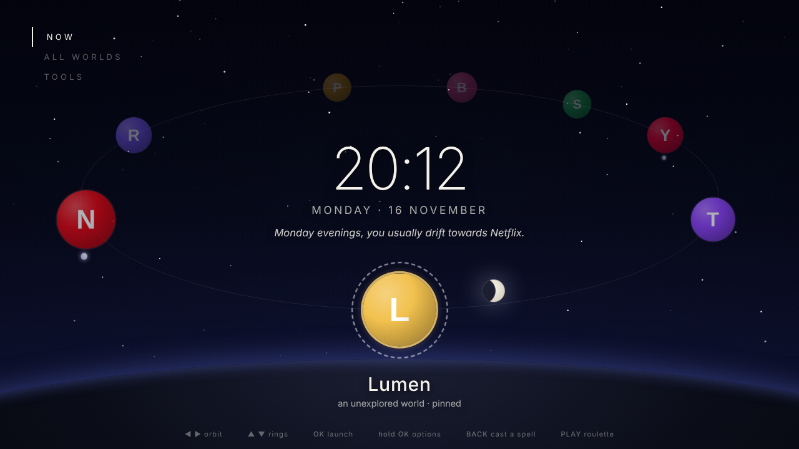

# Orbit — a TV launcher where your apps are worlds

An experimental home screen for Fire TV, Android TV and Google TV boxes. The usual grid of rows is gone. Your apps orbit a clock under a real sky.



## What's different

| Idea | What it does |
|---|---|
| **Orbit** | Apps sit on a tilted elliptical orbit around the clock. ◀ ▶ spins the orbit, ▲ ▼ warps between rings: **Now**, **All worlds**, **Tools**. |
| **Gravity** | Each planet's size is set by how often you opened that app in the last 30 days. Apps you never open shrink back. |
| **Tide** | The *Now* ring is rebuilt for the current hour and for weekday vs weekend. Morning apps come forward in the morning and evening apps in the evening. Pins always stay. |
| **Insights** | One quiet line under the clock, for example *"Monday evenings, you usually drift towards Netflix."* |
| **Spells** | On the home screen, press **BACK** (or MENU) and draw a D-pad pattern such as ↑→↓ to launch an app straight away. Hold OK on any planet and pick *Bind a spell* to set one. A small moon circles every planet that has a spell. |
| **Roulette** | Press **PLAY/PAUSE**, or open Roulette in Tools. The orbit spins, slows down and lands on a pick weighted by your habits. It never picks the app you just closed. You get 3 seconds to back out. |
| **Living sky** | The sky gradient, sun position, moon position and moon phase are worked out from your clock and timezone. You get stars and the odd shooting star at night, and a dawn glow on the horizon in the morning. |
| **Wind-down** | After your bedtime (23:00 by default, change it in Tools) the screen warms and the stars twinkle more slowly. Launching an app shows one breathing circle first, at most once every 30 minutes. |
| **Drift** | After 2 minutes idle everything fades except a large clock. |

Everything stays on the box: no account, no network, no tracking. Launch history is kept in the app's private storage, and *Tools → Forget my habits* clears it.

## Remote controls

| Key | Action |
|---|---|
| ◀ ▶ | spin the orbit |
| ▲ ▼ | change ring |
| OK | launch |
| hold OK (or ⏩ / ⏪) | planet options: pin, bind spell, hide, app info |
| BACK / MENU | cast a spell |
| PLAY/PAUSE | roulette |

## Build

GitHub Actions builds a signed APK on every push to `main` and publishes it to a release called `latest`:

```
https://github.com/<you>/<repo>/releases/download/latest/orbit.apk
```

That URL can be typed straight into the **Downloader** app on a Fire TV.

To build locally you need Android Studio, or the Android SDK plus JDK 17. Run `./gradlew assembleRelease`.

The repo includes a signing key (`app/orbit.jks`) so every build installs over the previous one. Replace it, or move the passwords into GitHub secrets, before you give the app to anyone else.

## Making it the home screen

* **Android TV boxes (Homatics etc.)**: some firmware shows a picker when you press Home. On stock Google firmware you usually have to disable the built-in launcher over ADB.
* **Google TV**: there's no setting for this. The common route is to disable the stock launcher over ADB, which is at your own risk and reversible with `pm enable`.
* **Fire TV**: Amazon doesn't let you replace the home screen. Orbit runs as a normal app there. Pin it to the front of your Fire TV apps row.

## How it's built

* `MainActivity.java` is a small native shell. It serves `assets/` from a private `https://orbit.local/` origin, renders app icons to PNG on demand, and exposes a bridge (`getApps`, `launch`, `load`/`save`, `openSettings`, `appInfo`). It forwards BACK, MENU and media keys to JavaScript, and it has no third-party dependencies.
* `assets/orbit.js` holds the whole experience: orbit physics, the habit model, the sky, spells, roulette and wind-down. It's written in ES5-style code so it also runs on older Fire OS WebViews.
* Open `app/src/main/assets/index.html` in a desktop browser for a preview with demo apps. Use the arrow keys, Enter (hold it for options), Esc for spells and P for roulette.
